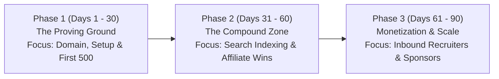

# TechJobsForIndia: 90-Day Implementation & Social Media Growth Blueprint

**Document Version:** 1.0  
**Project:** TechJobsForIndia (`techjobsforindia.com`)  
**Target Audience:** Indian Software Engineers, QA/SDETs, DevOps, Data Engineers & Hiring Teams  
**Strategy Type:** Faceless Organic Distribution & Multi-Channel Career Ecosystem  
**Author:** Ajay Paul & DeepMind Coding Agent  
**Last Updated:** October 2026  

---

## Executive Summary & Core Mindset

Building the product (3,300+ direct ATS links, modern UI, zero server cost) was the first 30%. The remaining 70% is **consistent organic distribution**.

### The 90-Day Law
> **"Never judge an online asset in the first 30 days. Content and SEO compound mathematically. The only commitment required is 15 minutes a day for 90 consecutive days."**

---

## 1. The Faceless Content Engine

You **do not need to show your face** on camera. In fact, a clean brand presence (@techjobsforindia) creates an enterprise-level perception of an authoritative tech job board.

```
┌────────────────────────────────────────────────────────────────────────┐
│                        Faceless Content Formats                        │
├────────────────────────────────────────────────────────────────────────┤
│ 1. Text-Only Value Drops (LinkedIn): Daily top 3 direct openings       │
│ 2. Screen-Recording Demos (Reels/Shorts): 30-sec UI & ATS bypass proof │
│ 3. Curated Carousels (Instagram): Salary benchmarks & Skill roadmaps   │
│ 4. Instant Mobile Blasts (Telegram): 5-minute job drop alerts          │
└────────────────────────────────────────────────────────────────────────┘
```

### The 5 High-Converting Content Pillars

| Pillar | Focus | Sample Headline / Angle | Distribution Channel |
| :--- | :--- | :--- | :--- |
| **1. 🚨 Daily ATS Job Drops** | Direct ATS openings with zero consultancy middlemen | *"3 verified direct tech jobs today (Swiggy, CRED, Zepto). No consultancies."* | LinkedIn, Telegram |
| **2. 💰 Indian Tech Salary Intel** | Real compensation comparisons | *"SDET II Compensation: Swiggy vs CRED vs Meesho (₹18L vs ₹24L vs ₹22L)"* | Instagram Carousels, Shorts |
| **3. 🎯 Career & Skill Roadmaps** | Upskilling and interview preparation | *"From Manual QA to SDET in 90 Days: Exact roadmap & free resources"* | LinkedIn, Instagram |
| **4. 🏢 Company Hiring Spotlights** | Unpacking interview process & tech stacks | *"Hiring breakdown: What Bosch/Razorpay actually asks in round 1"* | Shorts, Telegram |
| **5. 🛡️ The Anti-Spam Movement** | Exposing fake job consultancies | *"Why you should stop applying on Naukri & use direct ATS portals instead"* | LinkedIn, Reels |

---

## 2. Master 90-Day Phase-by-Phase Roadmap



### Phase 1: The Proving Ground (Days 1 – 30)
*Goal: Secure identity, build core channels, and reach the first 500 tech followers.*

- **Week 1 (Setup & Foundation):**
  - [ ] Register domain: `techjobsforindia.com` (with free WHOIS privacy).
  - [ ] Create official Google account: `techjobsforindia@gmail.com`.
  - [ ] Connect domain to GitHub Pages using CNAME and activate free HTTPS.
  - [ ] Set up LinkedIn Company Page: `TechJobsForIndia`.
  - [ ] Set up public Telegram Channel: `t.me/techjobsforindia`.
  - [ ] Install Google Analytics tag to measure real visitor metrics.

- **Weeks 2 – 4 (Daily Habit Formation):**
  - [ ] Post **1 text-only Job Drop on LinkedIn daily** (Monday to Friday at 9:30 AM IST).
  - [ ] Cross-post the same openings to the Telegram channel.
  - [ ] Share high-value posts to 2 tech WhatsApp groups or Reddit `r/developersIndia`.
  - [ ] **Expected Metric at Day 30:** 200–500 LinkedIn followers, 100–300 Telegram members, first ₹1,000–₹3,000 earned from affiliate clicks.

---

### Phase 2: The Compound Zone (Days 31 – 60)
*Goal: Expand to short-form video (faceless) and let SEO kick in.*

- **Weeks 5 – 8:**
  - [ ] Launch Instagram: `@techjobsforindia`.
  - [ ] Create **2 faceless 30-second screen-recordings per week** showing:
    - How to filter by "Remote" or "QA Automation" on the site.
    - Comparing compensation bands.
  - [ ] Repurpose every Instagram Reel as a **YouTube Short**.
  - [ ] Google search index begins sending organic candidate traffic to your 3,300+ indexed job pages.
  - [ ] **Expected Metric at Day 60:** 1,000–2,000 LinkedIn followers, 500–1,000 Telegram members, 5,000 monthly website visits. **₹8,000–₹15,000/month revenue.**

---

### Phase 3: Monetization & B2B Expansion (Days 61 – 90)
*Goal: Inbound recruiter outreach, featured employer posts, and sponsorship.*

- **Weeks 9 – 12:**
  - [ ] Launch weekly email digest on **Beehiiv**: *"Top 10 Direct Tech Openings This Week"*.
  - [ ] Direct employer outreach: Send messages to hiring managers whose jobs are featured:  
    *"Hey [Recruiter], your opening at [Company] received 140 direct candidate clicks this week on TechJobsForIndia. Would you like to pin your next opening at the top for ₹1,999?"*
  - [ ] EdTech partnerships (Topmate, Scaler, Educative) generate steady passive affiliate income.
  - [ ] **Expected Metric at Day 90:** 3,000–5,000 LinkedIn followers, 1,500+ Telegram subscribers, **₹20,000–₹40,000/month recurring income.**

---

## 3. Daily 15-Minute Operational Protocol

To prevent founder burnout, strictly follow this 15-minute daily workflow:

```
┌────────────────────────────────────────────────────────┐
│             The 15-Minute Daily Routine                │
├────────────────────────────────────────────────────────┤
│ 09:00 AM - 09:05 AM (5 Mins):                          │
│   • Open techjobsforindia.com                          │
│   • Pick 3 newly scraped verified tech jobs            │
│                                                        │
│ 09:05 AM - 09:12 AM (7 Mins):                          │
│   • Paste into LinkedIn using the copy-paste template  │
│   • Publish on LinkedIn Company Page                   │
│                                                        │
│ 09:12 AM - 09:15 AM (3 Mins):                          │
│   • Forward post to Telegram channel                   │
│   • DONE for the day! Close social media.              │
└────────────────────────────────────────────────────────┘
```

---

## 4. Ready-to-Use Copy-Paste Templates

### Template 1: Daily Job Drop (LinkedIn)

```text
🚨 3 Verified Direct-Apply Tech Openings in India (No Consultancies)

Tired of ghost jobs and recruitment spam on traditional portals? Here are 3 verified roles hiring right now with direct company ATS links:

1️⃣ [Company Name 1] — [Role Title]
📍 Location: [Location / Remote]
💼 Experience: [e.g. 2-5 yrs]
🔗 Direct Apply: techjobsforindia.com

2️⃣ [Company Name 2] — [Role Title]
📍 Location: [Location / Remote]
💼 Experience: [e.g. 3-6 yrs]
🔗 Direct Apply: techjobsforindia.com

3️⃣ [Company Name 3] — [Role Title]
📍 Location: [Location / Remote]
💼 Experience: [e.g. 1-3 yrs]
🔗 Direct Apply: techjobsforindia.com

👉 Browse 3,300+ verified direct career portal links (Greenhouse, Lever) on:
https://techjobsforindia.com

Follow TechJobsForIndia for daily verified openings.
#TechJobs #Hiring #IndiaTech #SoftwareEngineer #QAAutomation #RemoteJobs
```

### Template 2: The Anti-Spam Differentiator Post (LinkedIn / Telegram)

```text
The Indian tech job search is broken.

You spend 30 minutes tailoring a resume on Naukri. 
The next day, you get 5 WhatsApp calls from fake consultancies asking for ₹2,000 for "interview registration".

Meanwhile, top tech companies (Swiggy, CRED, Zepto, Meesho, Bosch) don't even look at consultancies — they hire through their private ATS portals (Greenhouse, Lever, Ashby).

That's why we built TechJobsForIndia:
✅ 3,300+ direct company ATS career links
✅ Zero placement consultancies or middlemen
✅ 100% free for Indian job seekers forever

Check open roles in your tech stack: https://techjobsforindia.com
```

---

## 5. Metrics & Tracking Scorecard

Track your weekly progress against these three indicators:

| Week | Metric to Watch | Target |
| :--- | :--- | :--- |
| **Week 2** | LinkedIn Post Impressions | 500+ impressions |
| **Week 4** | Telegram Subscribers | 100+ members |
| **Week 6** | Website Unique Visitors | 1,000+ monthly visits |
| **Week 8** | First Affiliate Conversion | First ₹500–₹1,000 earned |
| **Week 12** | First Paid Employer Post | First ₹1,999 B2B payment |

---

## Conclusion: The Secret is Simply Not Quitting

Your technical engine runs at **₹0 cost**. You have no monthly bills forcing you to close down.

If you execute this 15-minute routine every day for 90 days, you will build an undeniable, compounding digital media and career asset that pays you for months and years to come.
