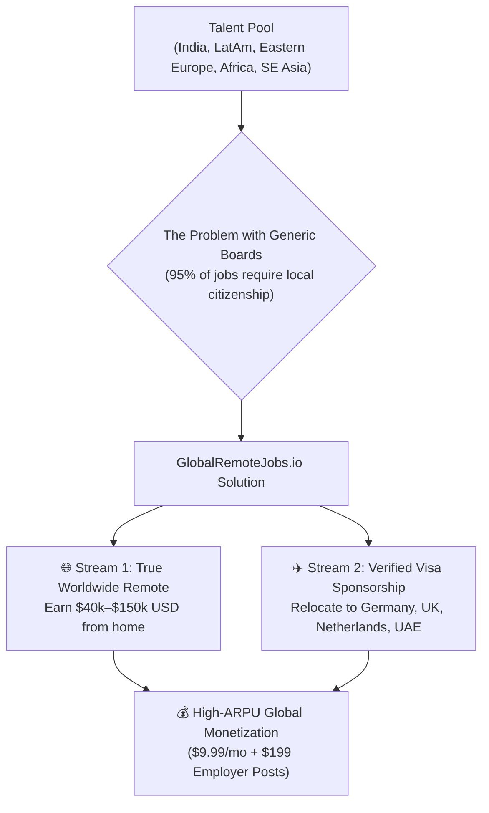
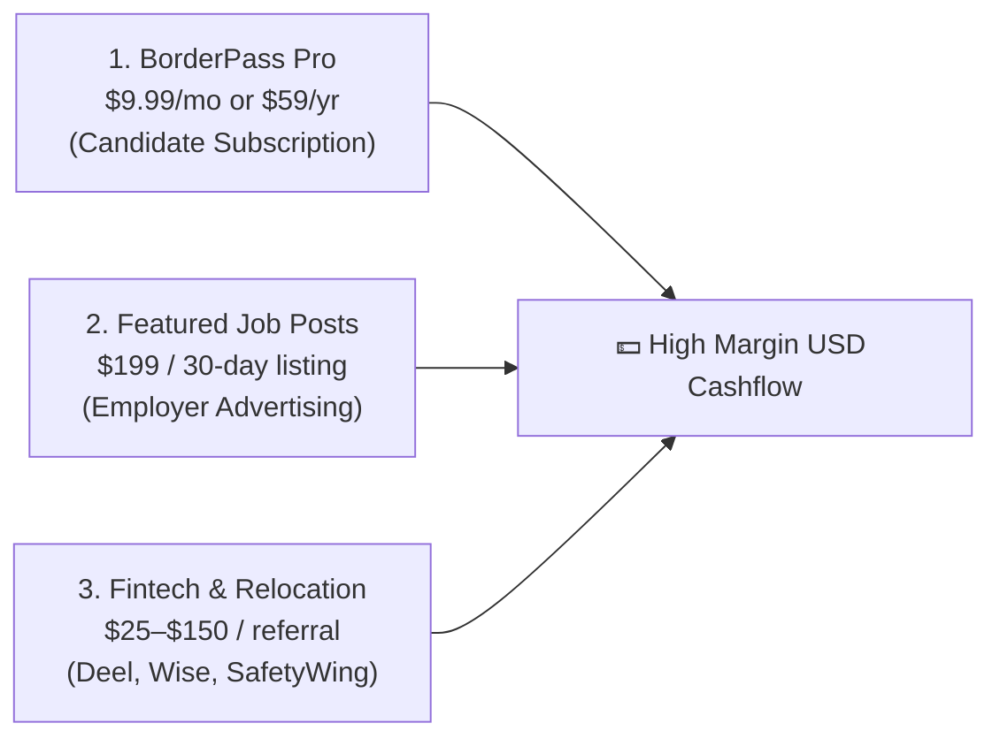
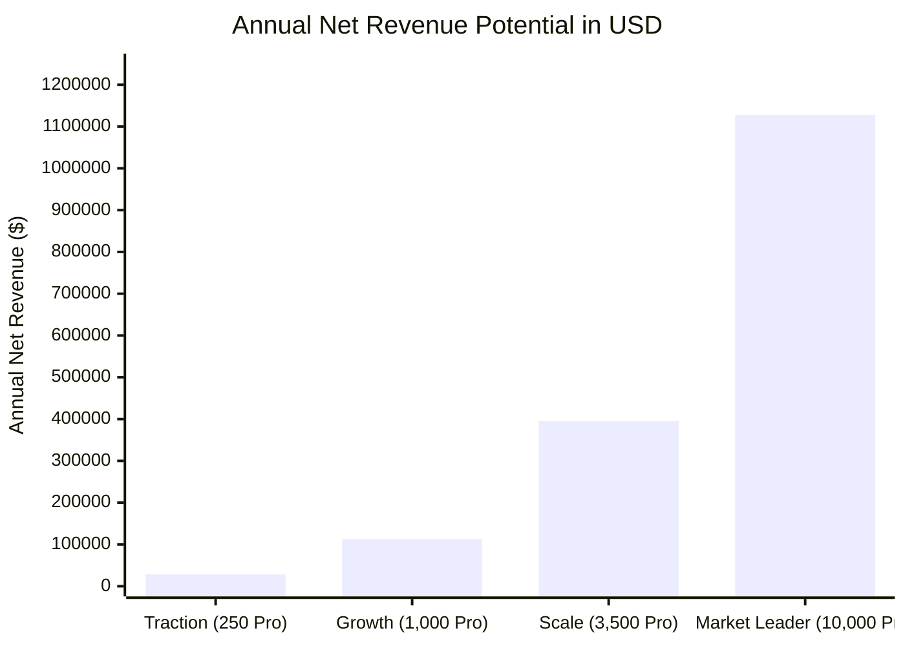
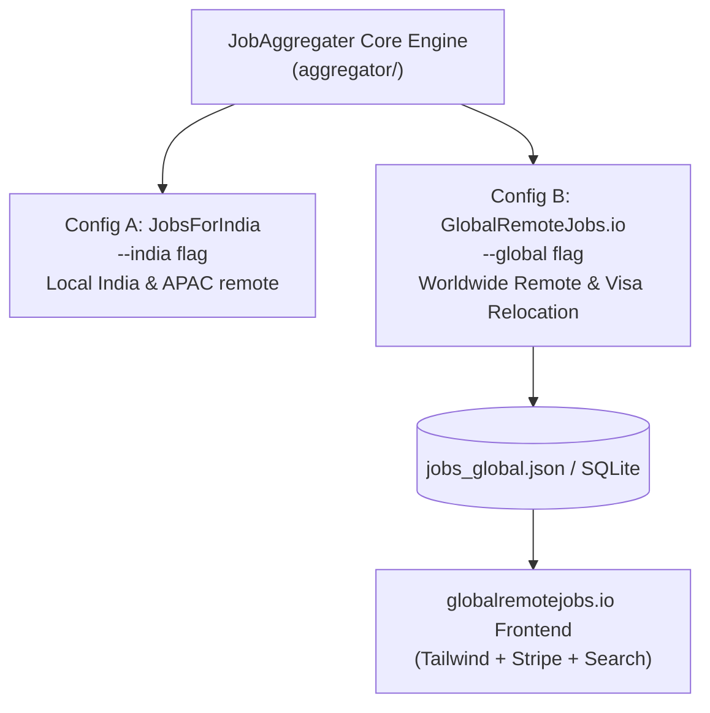

# GlobalRemoteJobs.io — Product Specification & Business Strategy

**Platform Name:** GlobalRemoteJobs.io  
**Document Version:** 1.0  
**Status:** Architecture Blueprint & Commercial Feasibility Study  
**Founder:** Ajay Paul  
**Date:** October 2026  

---

## Executive Summary

**GlobalRemoteJobs.io** is a specialized international career portal designed to solve the single largest barrier in global hiring: **borders and work authorization**.

Rather than attempting to compete with generic local job boards (like *Indeed* or *LinkedIn*) across 190 countries, GlobalRemoteJobs.io concentrates exclusively on the two most lucrative, high-demand employment segments in the world:
1. **Worldwide Remote (Work From Anywhere)**: Roles paying in USD / EUR that hire contractors or employees globally (via Deel, Remote, or direct contract) regardless of candidate nationality or timezone.
2. **Verified Visa Sponsorship & Relocation**: Companies in high-income hubs (Germany, United Kingdom, Netherlands, Canada, United Arab Emirates, Singapore) actively funding work permits, relocation flights, and visas for foreign tech talent.

By re-utilizing **90% of the existing JobAggregater ingestion architecture**, this platform can be deployed with minimal technical friction while targeting high-purchasing-power international users at **$9.99 to $19.99/month**.

---

## 1. The Global Market Opportunity



### The Broken Reality of International Job Hunting
* Over **100 million** skilled knowledge workers outside the US/EU actively seek foreign compensation or immigration opportunities.
* Searching on LinkedIn or Indeed is painful: 9 out of 10 search results for "Remote" are actually restricted (*"Must reside in the US"*, *"Must hold Green Card or EU citizenship"*).
* Candidates waste hundreds of hours applying to jobs that legally cannot hire them.

### The Unfair Advantage of GlobalRemoteJobs.io
Every job listed on GlobalRemoteJobs.io is machine-verified against strict criteria:
* **Zero Location Restrictions**: Tagged as *Anywhere in the World*, *Worldwide*, or *Global*.
* **Explicit Visa Sponsorship**: Mentions *Work Permit Sponsored*, *Visa Relocation Assistance*, *EU Blue Card Eligible*, or *UK Skilled Worker Sponsor*.

---

## 2. Core Feature Pillars

### Pillar 1: Worldwide Remote Engine (USD/EUR Pay)
* Ingests borderless developer, design, QA, product, and AI jobs.
* Tags contract types: Full-time Global Employee (EOR via Deel/Oyster) or Independent B2B Contractor.
* Real-time currency conversions to local currencies (INR, BRL, NGN, EUR).

### Pillar 2: The Visa Sponsorship Radar ✈️
* Algorithmic filtering of employer postings that include relocation packages.
* Supported destination markets:
  * 🇩🇪 **Germany** (EU Blue Card, Opportunity Card / Chancenkarte)
  * 🇬🇧 **United Kingdom** (Skilled Worker Visa)
  * 🇳🇱 **Netherlands** (Highly Skilled Migrant Scheme / 30% Ruling)
  * 🇦🇪 **United Arab Emirates** (Golden Visa / Green Visa tech roles)
  * 🇨🇦 **Canada** (Global Talent Stream)
  * 🇸🇬 **Singapore** (EP / Compass scheme)

### Pillar 3: Candidate VIP Suite ("BorderPass Pro")
* **1-Click Direct ATS Application**: Deep links bypassing third-party forms.
* **Instant Alerts**: Custom alerts pushed to Telegram, Discord, or Email the minute a matching visa-sponsored role appears.
* **AI Match & Resume Tailor**: Highlights key visa keywords that international ATS screeners scan for.

---

## 3. Revenue Models & Unit Economics

International users possess significantly higher willingness-to-pay than single-country domestic markets.



### 1. B2C Subscriptions (BorderPass Pro)
* **Pricing**: 
  * Monthly: **$9.99 / month**
  * Annual: **$59.00 / year** (~$4.90/month)
* **Target Audience**: Mid-to-senior engineers, DevOps, and product talent aiming for $50k–$150k remote contracts or overseas relocation.
* **Payment Stack**: Stripe Billing (Apple Pay, Google Pay, Credit/Debit Cards worldwide).
* **Payment Fees**: 2.9% + $0.30 per transaction (**94.1% Gross Margin** on $9.99).

### 2. B2B Employer Postings ("Hire Global Talent")
* Companies struggling with local US/EU tech talent shortages pay to access a pre-filtered global talent pool.
* **Pricing**: **$199** per 30-day featured posting (includes newsletter mention).
* **Competitor Benchmark**: *WeWorkRemotely* charges $299; *RemoteOK* charges $500+.

### 3. High-Ticket Affiliate Partnerships
| Partner Category | Example Partners | Estimated Commission |
| :--- | :--- | :--- |
| **Global Payroll & Contracting** | Deel, Remote.com, OysterHR | $100 – $500 per enterprise referral |
| **International Cross-Border Banking** | Wise, Revolut | $15 – $50 per funded account |
| **Digital Nomad Health Insurance** | SafetyWing, Genki | $10 – $30 recurring / customer |
| **Immigration & Visa Assistance** | Relocate.world, Jobbatical | 10% – 20% on consultation booking |

---

## 4. Multi-Tier Financial Projections



### Financial Forecast Table (Candidate Subscriptions Only)

| Tier | Active Subscribers | Monthly Gross | Stripe Processing (3.2%) | Monthly Net Profit | Annual Net (USD) | Annual Net (INR Equivalent) |
| :--- | :---: | :---: | :---: | :---: | :---: | :---: |
| **1. Early Traction** | 250 | $2,497 | $145 | **$2,352 / mo** | **$28,224 / yr** | **~₹23.7 Lakhs / yr** |
| **2. Growth** | 1,000 | $9,990 | $580 | **$9,410 / mo** | **$112,920 / yr** | **~₹94.8 Lakhs / yr** |
| **3. Scale** | 3,500 | $34,965 | $2,030 | **$32,935 / mo** | **$395,220 / yr** | **~₹3.32 Crores / yr** |
| **4. Market Leader** | 10,000 | $99,900 | $5,800 | **$94,100 / mo** | **$1,129,200 / yr** | **~₹9.48 Crores / yr** |

*(Note: Calculated strictly on $9.99/mo candidate subscriptions before adding B2B job postings or affiliate revenue).*

---

## 5. Technical Implementation: Reusing Existing Engine

Because the current JobAggregater codebase is modular, building GlobalRemoteJobs.io does **not** require starting from scratch.



### Code Modifications Required:
1. **New CLI Flag in `aggregator/main.py`**:
   ```bash
   python -m aggregator.main --global
   ```
2. **Visa Sponsorship & Worldwide Detection Engine (`aggregator/processing/filter.py`)**:
   * Add automated regex detection for relocation and visa sponsorship phrases:
     ```python
     VISA_PATTERNS = [
         r"\bvisa\s+sponsorship\b",
         r"\bwork\s+permit\s+provided\b",
         r"\brelocation\s+(?:support|package|assistance)\b",
         r"\beu\s+blue\s+card\b",
         r"\bvisa\s+support\b",
         r"\bwilling\s+to\s+sponsor\b",
     ]
     ```
3. **Frontend Localization**:
   * Multi-currency switcher (USD, EUR, GBP, INR).
   * Country destination tags (🇩🇪 Germany, 🇬🇧 UK, 🇨🇦 Canada, 🇦🇪 UAE, 🌐 Worldwide).
   * Integrated Stripe Checkout modal.

---

## 6. Go-To-Market (GTM) Strategy

### Organic Growth Channels (Zero Paid Ad Spend)
1. **Targeted SEO Pages**:
   * Programmatic SEO pages generated from the database:
     * `globalremotejobs.io/visa-sponsorship/germany`
     * `globalremotejobs.io/worldwide-remote/python-developer`
     * `globalremotejobs.io/relocation/uk-software-engineer`
2. **Community Sourcing**:
   * **Reddit**: Communities like `r/digitalnomad` (2.3M members), `r/IWantOut` (2.1M members looking to relocate), `r/cscareerquestions`, and `r/remotework`.
   * **LinkedIn Content**: Sharing weekly curated roundups of *"Top 10 European companies sponsoring work visas this week"*.
3. **Telegram & Discord Bot Network**:
   * Free broadcast channels notifying candidates of fresh visa-sponsored openings.

---

## 7. Strategic Roadmap

| Phase | Milestone | Deliverable |
| :--- | :--- | :--- |
| **Stage 1** | **Dataset Tagging** | Implement `--global` and regex visa detection in `aggregator/processing/filter.py`. |
| **Stage 2** | **Domain & Branding** | Setup landing page on `globalremotejobs.io` (or alternative domain) via Cloudflare/Vercel. |
| **Stage 3** | **Monetization Hook** | Connect Stripe Billing for $9.99/month "BorderPass Pro". |
| **Stage 4** | **Employer Onboarding** | Add "Post a Job ($199)" self-serve checkout for recruiters. |

---

## Conclusion

GlobalRemoteJobs.io transforms our existing aggregation technology into a **high-value, dollar-denominated global SaaS business**. 

By solving the specific immigration and location-eligibility friction that prevents global tech talent from finding legitimate international employment, the platform positions itself not as another commodity job board, but as an **essential global mobility platform**.

