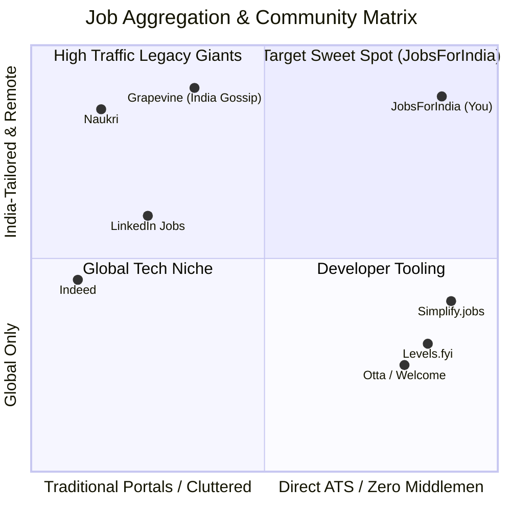
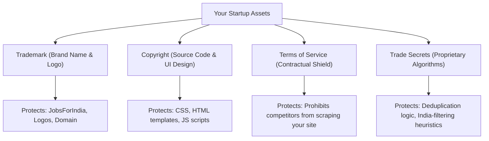
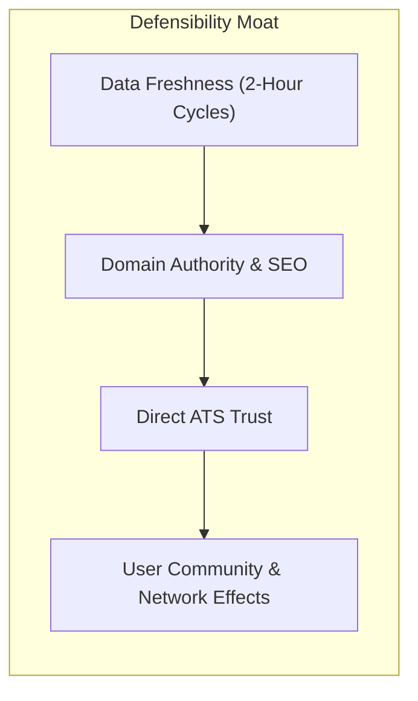
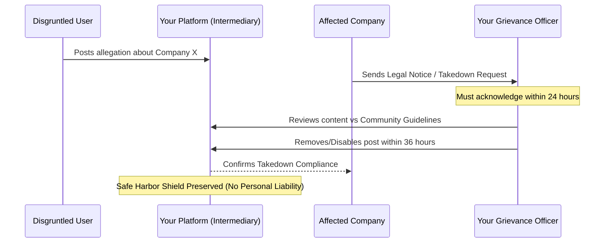
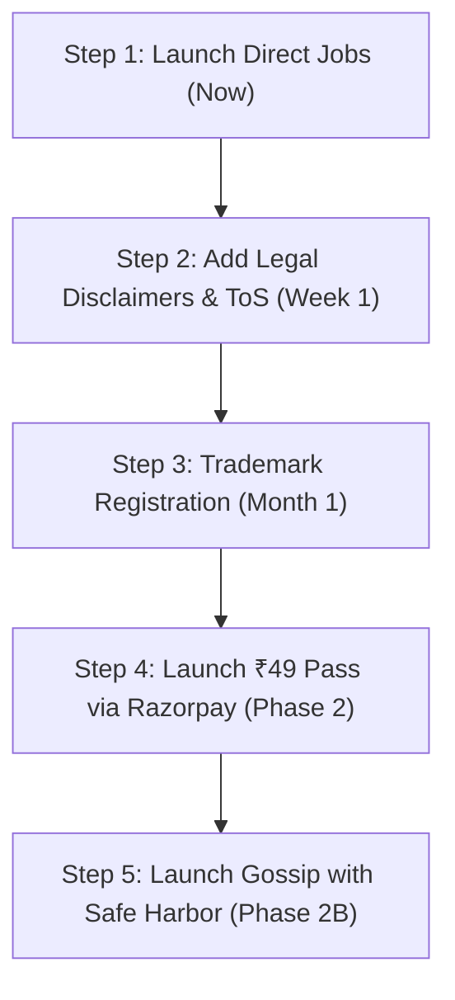

# Market Research, Competitor Landscape, IP Protection & Legal Compliance Guide

This strategic document provides a comprehensive market landscape analysis, competitive benchmarking, intellectual property protection roadmap, and legal/regulatory assessment for **JobsForIndia** (and its global counterpart **GlobalRemoteJobs.io**).

---

## Executive Summary

| Domain | Key Finding | Strategic Takeaway |
| :--- | :--- | :--- |
| **Market Validation** | Strong demand for spam-free, direct-to-ATS job discovery. | Traditional boards (Naukri, Indeed, LinkedIn) are cluttered with ghost jobs, recruiter spam, and consultancies. Candidates crave verified, direct links. |
| **Direct Competitors** | Simplify.jobs, Levels.fyi, Otta, Grapevine (India gossip), Blind. | No single platform combines hyper-affordable micro-pricing (₹49) with direct ATS links and an India-tailored remote focus. |
| **Idea Protection** | **Software ideas cannot be patented or copyrighted.** | Code and branding can be protected, but true defensibility comes from **data freshness, SEO distribution, and network effects**. |
| **Legal Status (Scraping)** | Generally legal under US & Indian precedents if data is public. | Querying public ATS boards (Greenhouse, Lever) carries low risk when pointing directly to employers. |
| **Legal Status (Gossip)** | **High Risk Area** under Indian Defamation Law. | Must strictly adhere to **Section 79 of the Information Technology Act (Intermediary Guidelines)** with a designated Grievance Officer. |

---

## 1. Market Research: Does an Application Like This Exist?

Yes, several platforms operate in adjacent or overlapping spaces. However, the market is fragmented between **high-friction enterprise aggregators** and **niche direct boards**.

### Competitive Landscape Matrix

### Direct & Indirect Competitor Profiles

#### 1. Simplify.jobs (US / Global)
- **What they do**: Aggregates verified ATS job postings (Greenhouse, Lever, Workday) and provides a Chrome extension that 1-click autofills applications.
- **Traction**: Over 1M+ active student and tech applicants.
- **Monetization**: Free for candidates; charges employers to feature listings and access talent pools.
- **Gap they leave**: Primarily US-centric; lacks curated filtering for Indian candidates seeking verified remote roles.

#### 2. Levels.fyi & Otta (Tech Focus)
- **What they do**: Verified tech openings linked directly to company career sites, paired with salary data (Levels.fyi) and personalized matching (Otta).
- **Monetization**: Employer recruitment advertising, talent search fees ($5,000+ per hire).
- **Gap they leave**: Heavily skewed towards Silicon Valley, London, and Tier-1 senior engineers; does not address entry-level/mid-level Indian regional hubs.

#### 3. Grapevine (India's Corporate Watercooler)
- **What they do**: Anonymous, verified workplace gossip community for Indian techies (requires company email verification).
- **Traction**: Extremely popular in Bengaluru, Gurgaon, and Hyderabad for compensation leaks, layoff updates, and toxic culture warnings.
- **Monetization**: Premium anonymous AMA sessions, sponsored recruitment posts.
- **Gap they leave**: Grapevine is purely a community feed; its job search and discovery capabilities are rudimentary.

#### 4. Legacy Giants (Naukri, LinkedIn, Indeed)
- **Weaknesses**:
  - Overrun with recruitment agency spam and third-party "consultancies" selling candidate data.
  - Ghost jobs (expired listings left active for weeks).
  - High friction (requires 10-step account creation and resume uploading before viewing application links).

### Your Unique Value Proposition (The "White Space")
1. **Zero Registration to Browse**: Instant access to verified Greenhouse/Lever/SmartRecruiters links.
2. **India & Global Remote Tagging**: Solves the biggest pain point for Indian techies ("Does this US/EU remote job actually hire from India?").
3. **The ₹49 Micro-Price Point**: Traditional portals charge candidates ₹1,500–₹3,000/month for "Naukri FastForward" or "LinkedIn Premium". ₹49 for 3 months acts as an impulse buy for genuine job seekers.

---

## 2. Idea Protection: How to Protect Against Competitors Copying

> [!WARNING]
> **Fundamental Reality of Startup Law**: In software, **ideas cannot be patented or copyrighted**. Only the *specific source code, branding, and proprietary databases* are protected. Anyone in the world can legally build a job aggregator or a workplace gossip forum.

### 1. What You CAN Legally Protect

#### A. Trademark Protection (Priority #1)
- **What it covers**: Your brand name (`JobsForIndia`, `GlobalRemoteJobs.io`), unique slogans, and logo.
- **Action**: Register the trademark with the **Controller General of Patents, Designs and Trade Marks (India)** under:
  - **Class 35**: Employment agency services, job boards, advertising.
  - **Class 42**: Software as a Service (SaaS), provision of search engines.
- **Cost**: ~₹4,500 government fee for individuals/startups per class.

#### B. Copyright (Automatic)
- Your original frontend design, unique iconography, CSS styling, and codebase are automatically protected by copyright law under the **Indian Copyright Act, 1957** and the **Berne Convention**.
- If a competitor clones your exact repository, UI layout, or graphics byte-for-byte, you can issue an instant **DMCA Takedown Notice** to their web host, Cloudflare, or GitHub.

#### C. Terms of Service & Anti-Scraping Protection
- Add a legally binding **Terms of Service** to your footer prohibiting:
  - Automated crawling or harvesting of your dataset.
  - Commercial redistribution of your aggregated listings.
  - Reverse engineering of your search filters.
- Violators breach contractual terms, giving you legal grounds to send Cease & Desist letters.

---

### 2. How to Build an Uncopyable Business "Moat"

Because code can be rewritten, your real protection comes from building an operational moat:

1. **Scraping Velocity & Pipeline Depth**:
   - If your connectors aggregate from 30+ ATS boards and 10+ APIs every 3 hours with 0% broken links, competitors relying on manual curation or stale feeds cannot match your utility.
2. **Network Effects on the Gossip Board**:
   - Code for a forum can be built in a weekend. But a forum with 10,000 active Indian developers sharing real salary data and interview questions cannot be copied, because users go where other users already exist.
3. **SEO Lead with Google Jobs**:
   - The `ld+json` Schema.org markup already embedded in your dashboard allows Google to index your jobs directly into Google Jobs Search. Once you rank organically, competitors must pay heavy ad costs to compete.

---

## 3. Legal Issues, Risks & Compliance Guide

Operating a job aggregator and an anonymous gossip community touches several areas of law.

### Risk Overview Matrix

| Category | Risk Level | Governing Law / Precedent | Primary Mitigation |
| :--- | :--- | :--- | :--- |
| **Job Scraping & ATS Ingestion** | **Low** | *hiQ Labs v. LinkedIn*, Indian IT Act Sec 43 | Aggregate only public data; direct candidates to ATS apply portals. |
| **Company Trademarks / Logos** | **Low–Medium** | Trademark Fair Use Doctrine | Add standard disclaimer; use nominative fair use to identify employers. |
| **Micro-Subscriptions (₹49)** | **Low** | RBI Recurring Mandate, GST Rules | Use Razorpay / Cashfree; enforce clear no-refund / instant access terms. |
| **Data Privacy (DPDP Act 2023)** | **Medium** | Digital Personal Data Protection Act 2023 | Encrypt user emails, do not store plain passwords, provide account deletion. |
| **Anonymous Gossip / Watercooler** | **CRITICAL** | IPC Sec 499 (Defamation), IT Rules 2021 | Implement Section 79 Intermediary Safe Harbor, Grievance Officer, profanity filters. |

---

### Deep Dive 1: Is Scraping Public Job Boards Legal?

**Yes, with boundaries.**

1. **The *hiQ Labs v. LinkedIn* Precedent**:
   - The US Federal Court of Appeals affirmed that scraping **publicly accessible data** on the internet (without bypassing logins or paywalls) does not violate the Computer Fraud and Abuse Act (CFAA).
2. **Indian Legal Context (IT Act 2000)**:
   - Section 43 of the IT Act penalizes unauthorized extraction of data from computer systems. However, reading public ATS endpoints (like Greenhouse boards: `https://boards-api.greenhouse.io/v1/boards/{company}/jobs`) is accessing data that companies **deliberately publish to the open internet to attract candidates**.
3. **Why ATS Companies Welcome Direct Traffic**:
   - Employers pay Greenhouse, Lever, and Workday thousands of dollars per month specifically so people apply. By directing qualified candidates straight into their ATS pipelines with clean referral headers, you are helping employers fill roles.
4. **Rules of the Road**:
   - Never bypass login screens, CAPTCHAs, or authentication tokens.
   - Respect `robots.txt` rate limits (do not send 500 requests/second that could crash their servers).
   - Direct the user to the employer's official domain for the final submission.

---

### Deep Dive 2: Using Company Names and Logos (Nominative Fair Use)

When you display "Software Engineer at Google" or show a logo:
- Under Indian trademark law (Section 30 of the Trade Marks Act, 1999) and US trademark law, **Nominative Fair Use** allows you to use another entity's trademark strictly to identify their products or services (e.g., that the job opening belongs to that company).
- **Mandatory Requirements**:
  1. Do not use the logo in a way that suggests endorsement, partnership, or official sponsorship.
  2. Add a clear footer disclaimer:
     > *"All company names, logos, and trademarks are the property of their respective owners. Their use on this website is for informational and identification purposes only and does not imply any affiliation, sponsorship, or endorsement."*

---

### Deep Dive 3: Anonymous Corporate Gossip (The Highest Legal Risk)

If you allow users to anonymously post workplace reviews or gossip, you face immediate exposure to **criminal and civil defamation** under Sections 499 & 500 of the Indian Penal Code (and the Bharatiya Nyaya Sanhita).

#### The Safe Harbor Shield: Section 79 of the IT Act (2000)
To avoid being sued personally whenever a disgruntled employee posts allegations about a company CEO:

To maintain **Intermediary Safe Harbor**, you MUST satisfy the **Information Technology (Intermediary Guidelines and Digital Media Ethics Code) Rules, 2021**:
1. **Designate a Grievance Officer**: Publish their name, email, and Indian address on your website footer.
2. **Strict 24h/36h Takedown Timelines**:
   - Acknowledge complaints within **24 hours**.
   - Take down unlawful, defamatory, or infringing content within **36 hours** of receiving notice.
3. **Automated Content Moderation**:
   - Block individual names in gossip posts (enforce naming companies, not individual managers).
   - Use an automated profanity/libel filter (e.g. blocking phrases like "sexual harassment", "scam", "fraud", "bribe" unless verified through formal legal reporting).
4. **Maintain Access Logs for 180 Days**:
   - The law requires intermediaries to store user IP logs and registration details for 180 days to provide to law enforcement if subpoenaed.

---

### Deep Dive 4: Data Protection & Payments Compliance (India)

1. **Digital Personal Data Protection (DPDP) Act, 2023**:
   - Obtain clear, affirmative consent when collecting user email/phone for the ₹49 subscription.
   - Do not sell or leak candidate data to third-party recruitment agencies.
   - Provide an automated "Delete My Account & Data" button in user settings.
2. **RBI Guidelines for Subscriptions**:
   - In India, auto-debit recurring subscriptions require e-mandate AFA (Additional Factor Authentication).
   - **Recommended Approach**: Do not make ₹49 auto-recurring. Offer it as a **one-time upfront pass for 90 days access** (₹49 one-time). This bypasses complex recurring mandate compliance and eliminates credit card chargeback disputes.
3. **Payment Gateway Integration**:
   - Use **Razorpay** or **Cashfree**. They provide pre-built checkout pages that handle UPI, debit cards, and net banking with built-in GST compliance.

---

## 4. Strategic Recommendations & Action Plan

| Phase | Action Item | Urgency | Estimated Cost |
| :--- | :--- | :--- | :--- |
| **Phase 1 (Immediate)** | Publish Terms of Service, Privacy Policy, and Trademark Disclaimer on website. | High | Free (Standard startup templates) |
| **Phase 1 (Immediate)** | Maintain zero-friction access to validate traffic and establish SEO presence. | High | Free |
| **Phase 2A (Monetization)** | Integrate Razorpay for one-time ₹49/90-day access (avoiding recurring auto-debit mandates). | Medium | 2% + GST gateway fee |
| **Phase 2A (IP)** | File Indian Trademark application for your chosen brand name. | Medium | ₹4,500 govt fee |
| **Phase 2B (Gossip)** | Appoint a Grievance Officer and implement 36-hour takedown workflow before launching community features. | Critical before launch | Free / Operational effort |

