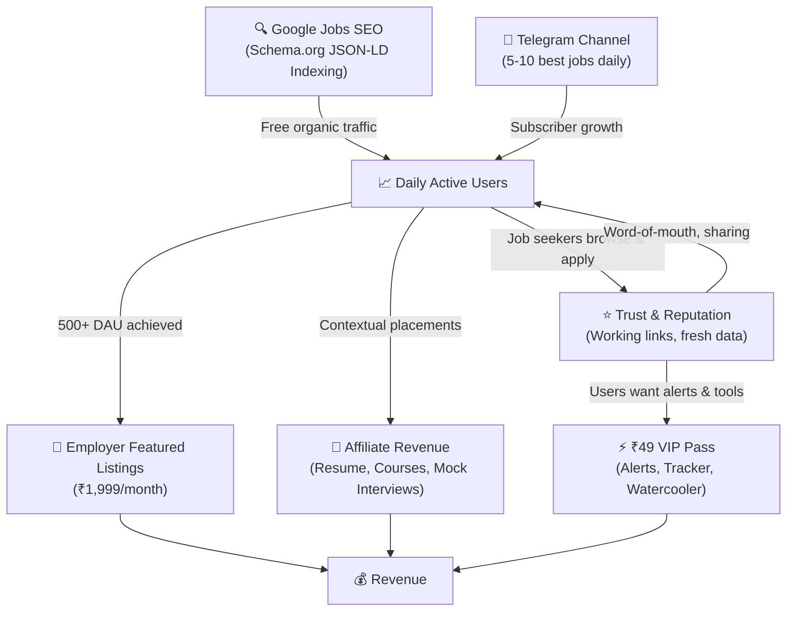
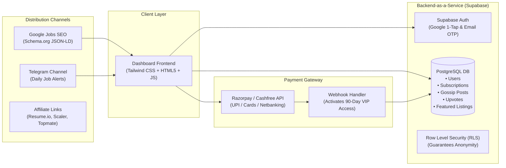
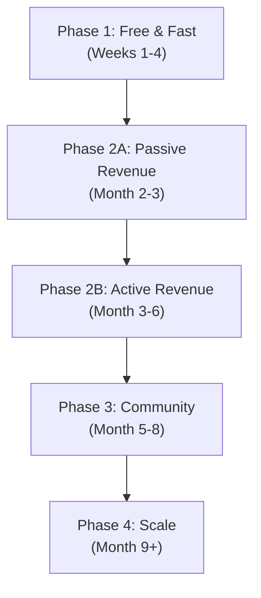

# JobsForIndia: Revised Product Strategy & Business Model

**Document Version:** 2.0  
**Status:** Active Product Roadmap & Business Architecture  
**Prepared For:** Ajay Paul (Founder)  
**Date:** October 2026  

---

## Executive Summary

Phase 1 established a zero-cost, legal aggregation engine collecting **6,700+ jobs** and **1,500+ verified India-eligible positions** with direct ATS links from top employers (Bosch, MongoDB, Databricks, Stripe, CRED, Meesho, etc.).

**Phase 2** pivots the monetization strategy from a candidate-facing paywall (which creates friction and drives users away) to a sustainable three-pillar revenue model:

1. **Employer-Side Featured Listings** (Primary Revenue): Charge startups and companies ₹1,999/month to pin their openings at the top of the board.
2. **Affiliate Revenue** (Passive Income): Contextual affiliate links next to job listings for resume builders, courses, and mock interview services.
3. **₹49 VIP Pass** (Premium Tools, NOT gated job links): Unlock WhatsApp/Telegram job alerts, application tracker, and full Watercooler posting access.

The core job search, browse, filter, and apply functionality remains **100% free forever** — because traffic and trust are the foundation everything else is built on.

---

## 1. Strategic Pivot: Why We Removed the Paywall

### The Problem with Gating Job Links

The previous model (4 free applies/day, then ₹49 to unlock more) had a fatal flaw:

- **Job application links are public.** Every Greenhouse/Lever ATS URL we aggregate is freely available via Google. Charging for access to public URLs feels predatory and drives users to competitors.
- **Conversion math is brutal.** Even with 10,000 monthly visitors, realistic paywall conversion yields ~18 paying users/month (~₹882). Not a business.
- **Indian job seekers are extremely price-sensitive.** They won't pay for convenience when the inconvenience is a 5-second Google search.
- **The paywall trains users to leave.** After 4 free clicks, they've learned the company names and ATS patterns. They bookmark and Google directly — never returning.

### The New Philosophy

> **Don't charge people to find jobs. Charge employers to find candidates, and charge job seekers for intelligence and productivity tools.**

This is how every successful job board in history makes money — Indeed, LinkedIn, Naukri — they all charge employers, not candidates.

---

## 2. Revenue Model: Three Pillars

### Pillar 1: Employer Featured Listings (Primary Revenue)

**Target:** Indian startups and tech companies actively hiring.

| Item | Value |
| :--- | :--- |
| **Price** | ₹1,999 / month per featured listing |
| **What they get** | Job pinned at top of board with "⭐ Featured" badge, priority in search results, highlighted card styling |
| **Target clients** | CRED, Zepto, Meesho, Razorpay, Groww, PhonePe, Swiggy, and 100+ funded Indian startups |
| **Revenue at 10 employers** | **₹19,990 / month** |
| **Revenue at 25 employers** | **₹49,975 / month** |

**Sales Pitch:**
> *"JobsForIndia gets thousands of active Indian tech candidates looking for verified, direct jobs every month. Feature your open roles at the top of our board for ₹1,999/month — cheaper than a single LinkedIn job post (₹15,000+)."*

**Prerequisites:**
- Minimum 500 daily active users to make the pitch credible
- Google Analytics / Plausible installed to show traffic proof
- Professional landing page with employer-facing CTA

---

### Pillar 2: Affiliate Revenue (Passive Income)

Place contextual, non-intrusive affiliate links next to job listings:

| Placement | Affiliate Partner | Revenue per Conversion |
| :--- | :--- | :--- |
| Next to "Senior React Engineer" listing | Scaler Academy / AlmaBetter (React course) | ₹1,500 – ₹3,000 |
| Below "Apply Now" button | Resume.io / Novoresume (ATS Resume) | ₹200 – ₹500 per signup |
| "Prepare for this interview" link | Topmate 1-on-1 mock interviews | ₹300 – ₹800 |
| Newsletter signup popup | Recruitment agency referrals | ₹2,000 – ₹5,000 per hire |

**Revenue Estimate:**
- 1% conversion on 3,000 monthly active users = 30 conversions
- At ₹500 average = **₹15,000/month with zero user friction**

---

### Pillar 3: ₹49 VIP Pass (Premium Tools — NOT Gated Job Links)

The ₹49 / 3-month pass unlocks productivity tools and intelligence — but **never gates the core job search or apply links**.

| Feature | Free (Unlimited) | VIP Pass (₹49 / 3 Months) |
| :--- | :---: | :---: |
| **Browse all jobs** | ✅ Unlimited | ✅ Unlimited |
| **Search & all filters** | ✅ Full access | ✅ Full access |
| **Apply via ATS links** | ✅ **Unlimited (no daily cap)** | ✅ Unlimited |
| **Save / bookmark jobs** | ✅ | ✅ |
| **Track applied jobs** | ✅ Basic | 🔥 **Full Kanban tracker** (Applied → Interview → Offer) |
| **Job alerts** | ❌ | 🔥 **Instant WhatsApp / Telegram alerts** when matching jobs drop |
| **Weekly digest email** | ❌ | 🔥 **Curated "Top 10 new jobs for your skills" weekly email** |
| **Salary estimator** | ❌ | 🔥 **Community salary data** for each listing |
| **Corporate Watercooler** | 👀 Read-only | 🔥 **Post, comment & upvote anonymously** |

**Revenue Estimate:**
- At 200 paying users/quarter = **₹9,800/quarter (~₹3,266/month)**
- This is supplementary income, not the primary revenue driver

---

## 3. The Growth Flywheel



---

## 4. Expense to Revenue Input (Unit Economics & ROI)

### Core Operating Metrics
```
Every ₹100 earned through this platform:
━━━━━━━━━━━━━━━━━━━━━━━━━━━━━━━━━━━━━━━━
💳 Gateway Fee (UPI):    ₹ 2.36
💻 Server/Hosting Cost:  ₹ 0.12 (near zero)
💰 YOUR NET PROFIT:      ₹ 97.52
━━━━━━━━━━━━━━━━━━━━━━━━━━━━━━━━━━━━━━━━
Gross Profit Margin: ~97.5%
```

### Detailed Expense vs. Revenue Input by Stage

| Stage & Timeline | Monthly Active Visitors | Monthly Expenses (Input) | Projected Monthly Revenue (Output) | Net Monthly Profit |
| :--- | :---: | :---: | :---: | :---: |
| **Stage 1: Launch (M1–M2)** | 100 – 300 / day | **₹60** (Domain amortized) | **₹0 – ₹3,000** (initial affiliate test) | **~₹0 – ₹2,940** |
| **Stage 2: Early Traction (M3–M5)** | 500 – 1,000 / day | **₹260** (Domain + 2.36% gateway fee) | **₹14,986** (4 featured jobs + 10 affiliates + 30 VIPs) | **₹14,726** |
| **Stage 3: Growth (M6–M12)** | 1,500 – 3,000 / day | **₹845** (Domain + 2.36% gateway fee) | **₹50,745** (15 featured jobs + 35 affiliates + 200 VIPs) | **₹49,900** |
| **Stage 4: Scale (M18+)** | 5,000+ / day | **₹2,100** (Domain + gateway fee) | **₹1,08,136** (30 featured jobs + 80 affiliates + 500 VIPs) | **₹1,06,036** |

### Capital & Break-Even Analysis
- **Upfront Capital Required**: **₹700 – ₹800** total (single purchase of `.in` domain for 1 year).
- **Monthly Fixed Burn Rate**: **₹0** (Hosting, database, and automation pipelines leverage permanent free tiers).
- **Break-Even Point**: A single featured job sale (₹1,999) or 2 resume affiliate signups covers the entire annual infrastructure cost.

---

## 5. Operating Costs (Near-Zero Infrastructure)

| Infrastructure Component | Provider | Free Tier Limit | Cost at Launch |
| :--- | :--- | :--- | :--- |
| **Dashboard Frontend** | GitHub Pages / Cloudflare Pages | Unlimited bandwidth, global CDN | **₹0** |
| **Authentication & Database** | Supabase | 50,000 MAU, 500MB Postgres | **₹0** |
| **Payments Processing** | Razorpay / Cashfree | Pay-as-you-go (no monthly subscription) | **₹0** |
| **Job Aggregator Pipeline** | GitHub Actions | 2,000 CI minutes/month (runs daily in ~2 min) | **₹0** |
| **Analytics** | Plausible / Google Analytics | Free tier | **₹0** |
| **Alerts & Community Feed** | Telegram Bot API | Unlimited messages & subscribers | **₹0** |
| **Custom Domain (`.in`)** | Namecheap / Porkbun | 1-year registration | ~₹600–800 / year (~₹60/mo) |
| **Total Monthly Fixed Overhead** | — | — | **~₹60 / month** |

> [!TIP]
> Because fixed operating costs are essentially **₹60/month**, the platform is profitable from the very first transaction with **zero financial downside** or monthly burn rate.

---

## 6. Technical Architecture



---

## 7. Feature: Corporate Watercooler (Phase 3 — After 500+ DAU)

An anonymous corporate discussions feed with verified company tagging. **Only launch this after the core job board has traction.**

### Prerequisites Before Launch
1. **500+ daily active users** — a gossip board with 0 posts is worse than no gossip board
2. **500+ seeded posts** across 50+ companies (seed manually under aliases if needed)
3. **Company email verification** (`@company.com`) — without this, gossip has zero credibility
4. **Lawyer-reviewed Terms of Service** — Indian defamation law (IPC 499/500) has criminal penalties
5. **Designated Grievance Officer** — required by IT Act Section 79 for Safe Harbor protection

### Core Components
1. **Anonymous Identity**: Random aliases (e.g., `BengaluruDev#402`, `PuneQA#118`)
2. **Company Tagging**: `#Bosch`, `#TCS`, `#Infosys`, `#Zepto`, `#CRED`
3. **Channels**: 💸 Compensation, 📉 Layoffs, 🚩 Red Flags, 🎯 Interview Experience
4. **Engagement**: Upvote/Downvote, threaded replies, sentiment tags

### Free vs VIP Access
| Feature | Free | VIP (₹49 Pass) |
| :--- | :---: | :---: |
| **Read all posts** | ✅ | ✅ |
| **Post & comment** | ❌ | ✅ |
| **Upvote / downvote** | ❌ | ✅ |
| **Full salary data** | Basic snippets | ✅ Full access |

---

## 8. Legal & Compliance Summary

> [!IMPORTANT]
> All legal requirements from the original market research remain in effect. See [MARKET_RESEARCH_LEGAL_IP.md](./MARKET_RESEARCH_LEGAL_IP.md) for full details on:
> - Section 79 IT Act (Intermediary Safe Harbor)
> - DPDP Act 2023 (Data Protection)
> - Trademark registration
> - Nominative Fair Use for company logos
> - RBI guidelines for one-time payments

---

## 9. Prioritized Roadmap



| Phase | Milestone | Deliverables | Success Metric |
| :--- | :--- | :--- | :--- |
| **Phase 1** (Weeks 1-4) | **Free & Fast** | Remove paywall. Buy domain (jobsforindia.in). Deploy on Cloudflare Pages. Submit to Google Search Console. Launch Telegram channel. Install analytics. | 500+ daily visitors |
| **Phase 2A** (Month 2-3) | **Passive Revenue** | Add affiliate links (Resume.io, Topmate, Scaler). Add "Prepare for this role" contextual links. Track conversions. | First ₹5,000 in affiliate revenue |
| **Phase 2B** (Month 3-6) | **Active Revenue** | Build employer-facing landing page. Email 50 startups with featured listing pitch (₹1,999/mo). Integrate Razorpay for VIP pass (₹49). Add WhatsApp/Telegram job alerts for VIP users. | 5 paying employers + 50 VIP users |
| **Phase 3** (Month 5-8) | **Community** | Build Watercooler MVP. Set up Supabase Auth + DB. Company email verification. Seed 500+ posts. Legal review of ToS. Appoint Grievance Officer. | 100+ active Watercooler users |
| **Phase 4** (Month 9+) | **Scale** | Scale employer sales. Add more ATS connectors. Expand to non-tech roles. Consider mobile app. | ₹1,00,000+ monthly revenue |

---

## 10. Key Decisions & Principles

1. **Traffic first, revenue second.** Never sacrifice user growth for short-term revenue.
2. **Job links are always free.** This is a hard rule. The moment you gate job links, you lose trust.
3. **Google Jobs SEO is the #1 growth lever.** Free organic traffic from Schema.org indexing is worth more than any paid marketing.
4. **Charge employers, not candidates.** This is how every successful job board works.
5. **The Watercooler is the long-term moat.** But only launch it when you have users. A forum with 0 posts kills your brand.
6. **₹49 is for tools, not access.** Alerts, tracker, salary data, and posting access — never basic job search.

---

## Conclusion

The revised model replaces a friction-heavy candidate paywall with a three-pillar revenue strategy that:
- **Keeps the product free** → maximizes traffic and trust
- **Charges employers** → aligns incentives (they want candidates, you have candidates)
- **Offers premium tools** → genuine value proposition for serious job seekers
- **Adds passive affiliate income** → revenue with zero user friction

This is economically sound, operationally lightweight (₹0 infrastructure), and follows the proven playbook of every successful job platform in the world.
