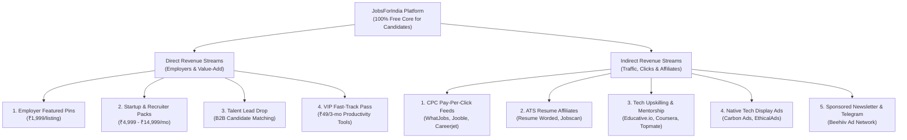

# JobsForIndia: Complete Revenue Streams & Monetization Blueprint

**Document Version:** 3.0  
**Project:** JobsForIndia (Curated Tech & Remote Jobs Platform)  
**Author:** Ajay Paul & DeepMind Coding Agent  
**Last Updated:** October 2026  
**Status:** Canonical Monetization & Business Strategy  

---

## Executive Summary & Core Principle

The historical downfall of tech job portals in India has been attempting to charge job seekers to view or apply to public job openings. Public ATS links (Greenhouse, Lever, Ashby, Workday) can be found with a 10-second Google search; gating them creates frustration and destroys user trust.

### The Golden Rule
> **"Never charge candidates to find, browse, or apply for jobs.  
> Charge employers for visibility & talent, and monetize traffic indirectly through CPC clicks, high-value career tools, and sponsored media."**

This document details every direct and indirect revenue stream available to JobsForIndia, including realistic unit economics, integration guides, and financial growth projections.

---

## 1. Master Architecture: Direct vs. Indirect Streams



---

## 2. In-Depth Breakdown: Direct Revenue Streams

### Stream 1: Employer "Featured Job" Pins (Primary Engine)
- **Target Audience:** Funded startups (CRED, Zepto, Swiggy, Meesho, PhonePe, Groww) and fast-growing Indian tech teams.
- **Price Point:** **₹1,999 per job listing for 30 days**.
- **Value Proposition:**
  - Pinned at the absolute top of the board above all aggregated jobs.
  - Distinctive `⭐ Featured Employer` badge, glowing amber/indigo border, and priority in search algorithms.
  - Broadcast once to the JobsForIndia Telegram channel and weekly newsletter.
- **Competitor Comparison:** LinkedIn charges ₹15,000–₹25,000+ per job post; Naukri charges ₹6,000+ per posting. At ₹1,999, JobsForIndia is an irresistible, low-risk impulse purchase for recruiters.
- **Revenue Potential:**
  - 10 jobs/month: **₹19,990**
  - 25 jobs/month: **₹49,975**
  - 50 jobs/month: **₹99,950**

### Stream 2: Employer Subscription Bundles
- **Startup Bundle (₹4,999/quarter):** Up to 3 active featured job posts at any given time.
- **Recruiter Unlimited (₹14,999/month):** Unlimited featured postings + direct company branding banner on the homepage.
- **Target Audience:** Tech recruitment consultancies and boutique hiring agencies that need continuous developer pipelines.

### Stream 3: Reverse Talent Directory (B2B Candidate Lead Drop)
- **How It Works:** Job seekers can optionally check a box: *"Make me visible to verified hiring recruiters"*.
- **The Product:** A private, weekly curated spreadsheet / portal containing 50–100 actively looking engineers, QA testers, and developers (contact details, GitHub, LinkedIn, portfolio).
- **Price Point:** **₹4,999/month** per recruiter for access to the candidate talent pool.

### Stream 4: Candidate VIP Productivity Pass (₹49 for 3 Months)
- **Important:** The core job links, search, and apply functions remain **100% free and unlimited forever**.
- **What ₹49 Unlocks:**
  - ⚡ **5-Minute Instant Telegram / WhatsApp Alerts** (be the first of 10 people to apply rather than the 500th).
  - 📋 **Interactive Kanban Job Tracker** (Saved ➔ Applied ➔ Interviewing ➔ Offer).
  - 💰 **Community Salary Insights** (reported compensation bands for similar roles).
- **Conversion Rate:** 2%–3% impulse buy among Indian freshers and mid-level engineers.
- **Revenue Potential:** 500 subscribers × ₹49 = **₹24,500**.

---

## 3. In-Depth Breakdown: Indirect Revenue Streams

Indirect streams generate continuous passive income from everyday candidate interactions without requiring direct payments.

### Stream 5: Pay-Per-Click (CPC / PPC) Job Publisher Networks

When candidates click "Apply" on partner-sponsored jobs, you earn money instantly on a pay-per-click basis.

```
Candidate Searches ──► Clicks "Apply" on Sponsored Card ──► Outbound Redirect ──► Revenue Credited (₹2 - ₹8)
```

| Network | Integration Type | Payout Rate (India) | Payout Rate (US/Global) | Payout Terms |
| :--- | :--- | :--- | :--- | :--- |
| **WhatJobs FeedAPI** | REST API (JSON/XML) | **₹3.00 – ₹8.00** / click | **₹18 – ₹45** / click | Monthly invoice (£/$/€ 50 threshold) |
| **Jooble Publisher** | REST API & Job Informer | **₹2.50 – ₹6.00** / click | **₹15 – ₹40** / click | Net 30 direct bank transfer |
| **Careerjet Partner API** | XML / JSON Feed (`careerjet.co.in`) | **₹2.00 – ₹5.00** / click | **₹12 – ₹35** / click | Monthly automated payout |
| **Adzuna Publisher API** | REST API | **₹2.50 – ₹7.00** / click | **₹20 – ₹50** / click | Direct publisher dashboard |

- **Integration Strategy:** We mix in 15%–20% sponsored CPC job listings natively into the job grid. To the user, they look like regular high-quality tech postings, but clicking "Apply" generates passive revenue.
- **Projected Earnings:**
  - 500 clicks/day @ ₹4 average = **₹2,000/day = ₹60,000/month**.

### Stream 6: Contextual ATS Resume Optimization Affiliates

Over 85% of applicants are rejected by automated Applicant Tracking Systems before a human sees their resume. Candidates viewing a specific job description are primed to check their resume compatibility.

| Affiliate Partner | Offering | Commission | Average Payout / Sale | Cookie Life |
| :--- | :--- | :--- | :--- | :--- |
| **Resume Worded** | AI Resume Review & ATS Score | **20% Recurring / Lifetime** | **₹800 – ₹1,600** ($10 – $20) | 20 days |
| **Jobscan** | Match Resume against Job Description | **15% – 30%** | **₹600 – ₹1,200** | 30 days |
| **Novoresume** | Professional Tech Resume Templates | Custom Affiliate Partnership | **₹400 – ₹900** | 30 days |

- **Placement:** Inside the Job Details Modal:
  > *"Match your resume against this job description to see your ATS score before applying."* ➔ `[Scan Resume (Free ATS Check) →]`
- **Projected Earnings:** 25 conversions/month = **₹20,000 – ₹35,000/month**.

### Stream 7: Tech Upskilling & Interview Preparation Affiliates

Every job description specifies required tech stacks (e.g., *React, Kubernetes, Playwright, Python, System Design*). Candidates who lack confidence in a requirement will seek quick upskilling or mock interview coaching.

| Partner | Category | Commission Rate | Typical Payout |
| :--- | :--- | :--- | :--- |
| **Educative.io** | Grokking the Coding/System Design Interview | **20% flat commission** | **₹1,200 – ₹2,500** per purchase |
| **Coursera** | Cloud Certifications (AWS, GCP, Azure, Python) | **15% – 45% commission** | **₹1,000 – ₹3,000** per enrollment |
| **Topmate.io** | 1-on-1 Mock Interviews with FAANG/Unicorn tech leads | **40% of platform fee** | **₹200 – ₹500** per booking |
| **LeetCode / AlgoExpert** | Technical interview algorithmic prep | 10% – 15% | **₹800 – ₹1,500** |

- **Projected Earnings:** 15 course/mock interview conversions/month = **₹18,000 – ₹30,000/month**.

### Stream 8: Native Tech & Developer Display Ads

Standard AdSense banners can look intrusive, but Developer-first Ad Networks maintain a clean, high-reputation design that tech candidates respect.

1. **Carbon Ads (BuySellAds):**
   - High-end developer network (used by Bootstrap, Vue.js, Laravel).
   - Single clean, non-intrusive card in the sidebar or between job listings.
   - Payout: **$1.50 – $4.00 CPM** (~₹120 – ₹320 per 1,000 pageviews).
2. **EthicalAds:**
   - Privacy-first tech ad network built for open-source and developer tools.
   - Zero cookie tracking (bypasses ad-blockers).
3. **Google AdSense:**
   - Fallback option; easy approval; CPM for Indian traffic ranges from ₹50 – ₹120.
- **Projected Earnings (at 50k pageviews/month):** **₹6,000 – ₹15,000/month**.

### Stream 9: Sponsored Newsletters & Telegram Broadcasts

An email list and Telegram channel create a direct, unblockable broadcast channel.

- **Platform:** **Beehiiv** (supports built-in programmatic Ad Network paying $1.00 – $2.50 per click).
- **Format:** Weekly Monday dispatch: *"Top 10 Direct Tech & Remote Jobs in India This Week"*.
- **Direct Sponsorship Rate:**
  - At 2,000 subscribers: **₹1,500 – ₹2,500** per issue.
  - At 5,000 subscribers: **₹4,000 – ₹6,000** per issue.
- **Projected Earnings (4 issues/month):** **₹8,000 – ₹24,000/month**.

---

## 4. Master Revenue Projection & Financial Model

### Financial Scenarios (INR Monthly)

| Revenue Source | Phase 1: Launch (Months 1-3) | Phase 2: Growth (Months 4-6) | Phase 3: Scale (Months 7-12) |
| :--- | :--- | :--- | :--- |
| **1. Employer Featured Posts** | ₹6,000 (3 posts) | ₹29,985 (15 posts) | ₹79,960 (40 posts) |
| **2. CPC Apply Clicks (WhatJobs/Jooble)** | ₹8,000 (2,000 clicks) | ₹28,000 (7,000 clicks) | ₹64,000 (16,000 clicks) |
| **3. ATS Resume Affiliates** | ₹5,000 (5 sales) | ₹16,000 (16 sales) | ₹35,000 (35 sales) |
| **4. Upskill / Interview Prep** | ₹4,000 (3 sales) | ₹12,000 (10 sales) | ₹25,000 (20 sales) |
| **5. VIP Pass (₹49)** | ₹2,450 (50 users) | ₹9,800 (200 users) | ₹24,500 (500 users) |
| **6. Newsletter / Telegram Sponsors** | ₹2,000 (1 sponsor) | ₹8,000 (4 issues) | ₹20,000 (multi-sponsor) |
| **7. Native Tech Display Ads** | ₹1,500 | ₹6,000 | ₹16,000 |
| **TOTAL ESTIMATED MONTHLY REVENUE** | **₹28,950 / month** | **₹1,09,785 / month** | **₹2,64,460 / month** |

### Operating Cost Structure (100% Bootstrapped)
- **Hosting:** GitHub Pages (₹0)
- **CI/CD Automation:** GitHub Actions (₹0 on public repository)
- **Database:** Flat JSON / CDN cached (₹0)
- **Domain:** ~₹800 / year (optional custom `.in` / `.com` domain)
- **Gross Profit Margin:** **> 98%**

---

## 5. Technical Integration Plan

### Milestone A: Quick Wins (Within 48 Hours)
1. **Job Details Modal ATS Checker:**
   - Embed an affiliate call-to-action button inside `dashboard/index.html` and `dashboard/app.js`:
     `📄 Check ATS Score for this Job (Powered by Resume Worded)`
   - Register account on Resume Worded / Jobscan affiliate program.
2. **Newsletter / Telegram Capture:**
   - Add a high-converting email capture pill in the dashboard header:
     `📬 Get 5 new direct jobs every morning via WhatsApp/Email`

### Milestone B: Employer Self-Serve Checkout (Within 1 Week)
1. **Razorpay Standard Checkout:**
   - Connect Razorpay payment link (₹1,999) to the **"Post a Job"** modal.
   - On successful payment webhook, auto-populate the job into `data/featured_jobs.json`.

### Milestone C: CPC Publisher Network Backfill (Within 2–3 Weeks)
1. **WhatJobs / Jooble REST API Integration:**
   - Register for publisher keys at WhatJobs FeedAPI and Jooble Publisher.
   - Add automated ingest script `scrapers/cpc_feed_ingest.py` to fetch verified India-eligible tech roles daily.
   - Tag outbound links with publisher tracking IDs to ensure revenue attribution.

---

## 6. Summary: Key Takeaways

1. **Keep the Core Free:** Job listings and direct application URLs must remain unencumbered to maximize candidate traffic, SEO ranking, and trust.
2. **Diversify Income:** Relying on a single revenue model is risky. Blending **Employer Posts (Direct)** with **CPC Apply Clicks & Affiliates (Indirect)** creates a resilient, multi-stream cash flow.
3. **Low Friction, High Volume:** A ₹1,999 employer post is 8x cheaper than LinkedIn, making it an easy sell to Indian tech startups.
4. **Zero Overhead:** Because the platform runs on GitHub Pages and Actions, virtually every rupee earned translates directly to pure operating profit.

